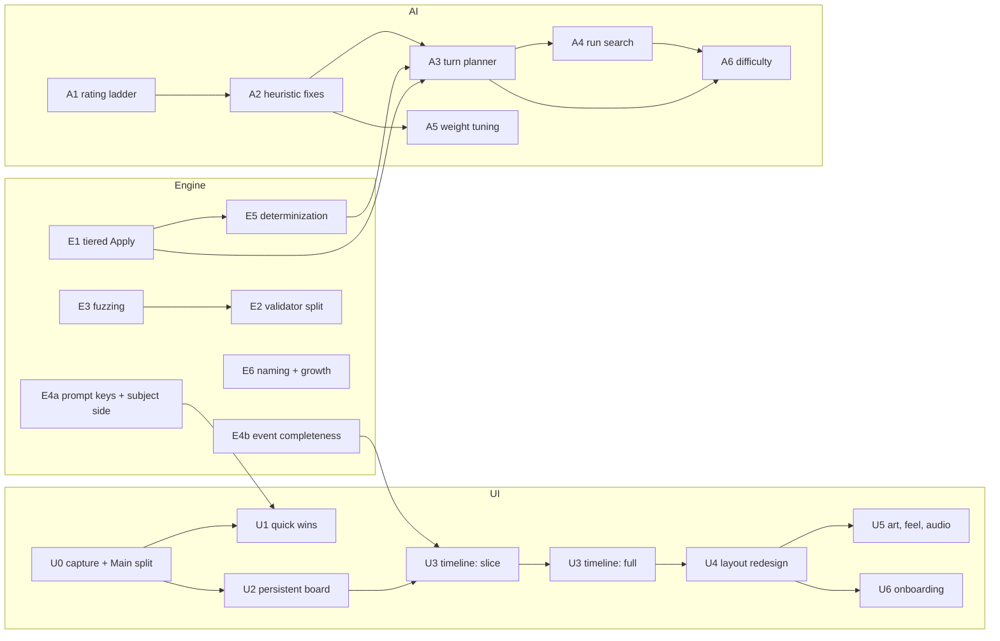

# Post-M5 improvement roadmap

Status: Waves 0 to 4.5 done ([Wave 4.5 summary](WAVE_4_5_PROGRESS.md#wave-45-summary-1-october-2026)); Wave 5 built ([progress](WAVE_5_PROGRESS.md)), awaiting its human playtest
Covers: [engine and architecture](ENGINE_ARCHITECTURE_PLAN.md) (E*),
[AI opponent](AI_OPPONENT_PLAN.md) (A*) and
[UI/UX redesign](UI_UX_REDESIGN_PLAN.md) (U*)

This document orders the phases of the three plans. The plans say *what* to
build and how each phase is verified. This roadmap says *when*, *why in that
order*, and what must be true before moving on.

## 1. Ordering principles

1. **Feel first, with enablers pulled in just in time.** The UI is the weakest
   part of the product today, so the critical path runs through the UI track.
   Engine phases are scheduled right before the UI or AI phase that needs them,
   not as a separate engine milestone.
2. **Safety net before refactors.** Random-legal fuzzing (E3) and the capture
   harness (U0) come first, because later phases change engine internals and
   the board renderer, and regressions there are otherwise found late.
3. **Measure before tuning.** The AI rating ladder (A1) comes before any
   change in bot strength, so every AI phase can show evidence.
4. **One vertical slice before widening.** The event timeline (U3) and the
   layout (U4) are first proven on a single Runner run and a single Corp score,
   then extended to every event.
5. **Keep the repository contracts.** Every phase keeps `make verify` green,
   leaves frozen benchmark digests unchanged unless it deliberately re-freezes
   them in a dedicated commit, and preserves the information boundary. Every
   wave gate also runs the full official gates (see section 3).

## 2. Dependency graph

The critical path is **U0 → U2 → U3 slice → U3 full → U4 → U5**. The AI track
has its own path, **A1 → A2 → (E1 + E5) → A3 → A4**, which can run alongside
the UI track in separate branches.

## 3. Waves

Sizes follow the plans: S is a few days, M is one to two weeks, L is several
weeks. The durations are rough ranges for one engineer switching between the
listed items, not commitments. Each wave ends at a gate; the next wave starts
once the gate passes.

Every wave gate includes the standard repository gates, run on the official
content snapshot, in addition to the wave-specific criteria below:

- `make verify`: formatting, tests, proofs, generated coverage and secret scan.
- `make m4-gate`: official client games in both seats and the resolution
  checks.
- `make m5-gate`: the full frozen headless suite. It covers the 1,000-game
  Standard and 100-game Easy self-play, the tactical suites, paired
  comparisons and worker-count determinism. `make m5-quick` is enough between
  gates, but not at one.
- `make m5-client-smoke`: the offline client flow, including save and resume.
- The M5 policy performance run (`ai-performance`) on the recorded reference
  hardware, whenever engine or policy code changed in the wave.

On a slower machine, run the gates with `NETRUNNER_TIMEOUT_SCALE` set (see the
README). It stretches only "give up after" limits, so a pass means the same
thing; performance budgets are still judged on the reference hardware.

If a wave deliberately changes frozen results, re-freeze the affected
manifests and fixtures in a dedicated commit, with the reason and the old and
new digests recorded in the wave's progress doc. Never regenerate held-out
seeds to hide an unfavorable result.

| Wave | Items | Rough length | Theme |
|---|---|---:|---|
| 0 | U0, E4a, E3 (CI part), A1 | 3–5 weeks | Tooling, safety nets and measurement |
| 1 | U1, E1, A2, A6a, E3 (nightly), E6 (renames) | 3–5 weeks | First visible wins; the engine gets fast; distinct difficulty |
| 2 | U2, E4b, U3 slice, E5 | 5–7 weeks | The board comes alive for one run and one score |
| 3 | U3 full, U4, E2 | 7–10 weeks | Real game feel |
| 4 | C1, U7, U5, U6, A1b, A4a, A5, A3, A4, A8 | 9–13 weeks | Real decks; polish, and the bot plans turns and searches runs |
| 4.5 | P1, P2, P3 | 3–5 weeks | Automated playtesting: lints and a local LLM find the bot's oddities |
| 5 | A6 (compute tiers, personalities), hardening, decision point | 2–4 weeks | Difficulty, release readiness |
| 5.5 | A9 (memory and inference) | 3–5 weeks | The bots remember what they saw and reason from it |

In total that's roughly 28–42 weeks. The UI track alone reaches "feels like a
game" at the end of Wave 3.

### Wave 0 — tooling, safety nets and measurement

| Item | Why now |
|---|---|
| U0 capture harness | Every later UI change needs before/after frames. Today's evidence had to be captured by hand. |
| U0 `Main` split | U1–U4 all edit the client; about 6K lines of smoke and gate code in `Main` makes that slow and risky. No behavior change. |
| E4a prompt keys and subject side | Small, and it removes the need for stopgap fixes in U1 (history labels, rules citations in the dock). |
| E3 random-legal fuzzing (CI part) | A cheap safety net before E1, E2 and U2 touch engine internals and rendering. |
| A1 rating ladder and human corpus | Nothing in the AI track can be judged without it. It needs no engine work. |

**Gate** (in addition to the standard gates above):
- The capture harness produces contact sheets for the run and score scenarios.
- The `Main` split changes no behavior: `make m4-gate`, `make event-smoke` and
  `make m5-client-smoke` pass unchanged.
- The dock shows no rules citations or step names, and the history side labels
  are correct.
- `make m5-gate` passes. If E4a adds serialized fields to Core events or
  prompts, the frozen replay hashes and deterministic digests change and must
  be re-frozen in a dedicated commit, with game outcomes, action sequences and
  tactical results otherwise identical to the M5 evidence. (Wave 0 derived both
  in `Netrunner.Match` instead, so the frozen results must be unchanged.)
- 50 fuzz games run in CI.
- The ladder separates Standard, Easy and random-legal per seat.

### Wave 1 — first visible wins; the engine gets fast

| Item | Why now |
|---|---|
| U1 quick wins | Visible improvements within weeks: correct history, player language, a visible score pile, a compact preview, and fixed z-order. |
| E1 tiered `Apply` | It unblocks A3 and E5, and the fuzzing from Wave 0 protects the refactor. |
| A2 heuristic fixes | Cheap strength gains (advancement inference, memory, breaker coverage, score race) measured on the A1 ladder. It also gives Wave 3's static evaluation its features. |
| A6a distinct difficulty | Wave 0 found Easy and Standard indistinguishable head to head (960 games). Make Easy measurably weaker with knobs that exist today (weights, the opponent-knowledge policy, a bounded rate of deliberately second-best choices), validated on the head-to-head ladder. Compute-based tiers wait for A3 in Wave 5. |
| E3 nightly fuzzing | Runs on official content once E1 exists, so large runs are affordable. |
| E6 renames | Low-risk cleanup while the affected files are being touched anyway. |

**Gate:**
- The U1 before/after contact sheets are reviewed.
- Simulation `Apply` is at least 5× faster than Authoritative, with the
  differential test green on the official corpus.
- A2 improves each side's ladder rating without lowering the other's.
- Head to head, Standard − Easy is separated (interval above zero) in both
  seats.
- A nightly run of at least 1,000 fuzz games is clean.

### Wave 2 — the board comes alive for one run and one score

| Item | Why now |
|---|---|
| U2 persistent board | It removes the bounce-back and early-arrival glitches, and U3 can't animate cards that are rebuilt on every update. |
| E4b event completeness | U3 needs an event, with payload, for every visible change. Scope it to the slice's events first. |
| U3 vertical slice | Only the advance, score, run start, encounter, subroutine fires and run end beats. This proves the timeline before building the whole catalog. |
| E5 determinization | Ready in time for A3 in Wave 3. It builds on E1. |

**Gate:**
- The captures show no duplicate or snap-back cards.
- A human-played Runner run and a Corp score are fully readable from the board
  alone, without the log.
- The presenter has zero snap mismatches on the slice's events.
- The sampler's self-consistency test (observation of the sample equals the
  input) passes, and so do the hidden-state twin tests.

### Wave 3 — real game feel

| Item | Why now |
|---|---|
| U3 full catalog | Extends the proven slice to every event in the catalog, and adds pacing and auto-pass settings. |
| U4 layout and interaction redesign | Needs U2 (persistent nodes) and U3 (overlays tied to beats). This is where the dock and the boxed columns go. |
| E2 validator split | By now E3 has built a corpus of known-bad states to prove authoritative commits still reject everything they did. Bot search already avoids validation through Simulation mode (E1), so this is about keeping authoritative play fast and the validator from becoming a second rules engine. |

**Gate:**
- A full game in each seat can be played without opening "All legal
  actions…".
- The capture review at 1920 and 2560 passes.
- Authoritative `Apply` rejects everything it did on the known-bad corpus, and
  validator time on the benchmark profile is measurably lower.

### Wave 4 — polish, and the bot plans turns and searches runs

| Item | Why now |
|---|---|
| C1 Gateway sample decks | First: the seven System Gateway-only sample decks from Null Signal Games use only cards we already implement, and tuning the bots further on the tutorial decks would fit them to two teaching decks. Every later bot item is measured on these decks. See below. |
| U7 main menu | With C1: the start screen is a developer scaffold (seed box, preset drop-downs, a metadata gallery button). C1's Tutorial and Gateway areas need a real menu to live in. See below. |
| A1b ladder over a deck pool | With C1: a fixed game budget sampled over deck pairings, sequential stopping, and per-deck warnings, so ladder time stays flat as decks are added ([plan](AI_OPPONENT_PLAN.md#a1b-ladder-over-a-deck-pool-m--with-c1-in-wave-4)). |
| U5 art direction, feel and audio | It only pays off once the layout (U4) is stable. |
| U6 onboarding and playtest loop | It needs the final interaction model from U4. |
| A4a whole-run model | First: per-server cost to get in and potential are the evaluation terms A3 lacked, and A4 builds on the same model. Inspired by chiriboga's run calculator (clean-room; it is GPL-3.0). |
| A5 fitted evaluation | Fit the evaluation to self-play outcomes over the A4a and A2 features, instead of hand-tuning. |
| A3 turn planner | Moved from Wave 3 ([record](WAVE_3_PROGRESS.md#a3-turn-planner)): the planning infrastructure works, but its end-of-turn evaluation didn't pick better turns. It returns on A4a and A5. |
| A4 run search | It builds on the A3 infrastructure and the A4a model, and adds the most for the Runner. |
| A8 Corp archetypes | Last: one policy that fits every deck plays each deck's plan badly (playtest, 28 September). The Corp plays to its deck's archetype instead. See below. |

**C1 Gateway sample decks (M).** Null Signal Games publishes
[sample decklists](https://nullsignal.games/players/getting-started-sample-decklists/);
seven are built from System Gateway alone:

| Side | Deck | Identity |
|---|---|---|
| Runner | Party Hard | René "Loup" Arcemont: Party Animal (Anarch) |
| Runner | Stolen Goods | Zahya Sadeghi: Versatile Smuggler (Criminal) |
| Runner | Planning Ahead | Tāo Salonga: Telepresence Magician (Shaper) |
| Corp | Discretion Advised | Haas-Bioroid: Precision Design |
| Corp | Advanced Yomi | Jinteki: Restoring Humanity |
| Corp | Hyper Velocity | NBN: Reality Plus |
| Corp | Quick and Dirty | Weyland Consortium: Built to Last |

All 77 Gateway cards, including these identities, are implemented. The
other 23 lists on that page need Elevation cards, so they wait for the next
card set.

1. **Data.** Commit the lists as card codes next to the existing presets
   (the card data stays local-only), under a new preset kind, `gateway`,
   alongside `starter` and `expanded`. `OfficialPresetCatalog` validates each
   list against the Gateway card counts and deck-building rules (minimum
   size, influence, agenda points).
2. **Deck choice in the menu (built in U7).** Two areas. **Tutorial**: the Catalyst and Syndicate
   starter and expanded decks, as today, for learning the game. **Gateway**:
   pick your seat's sample deck and the opponent's (or random), with each
   deck's identity, faction and a one-line description. The CLI, the saves
   and the ladder take the same deck IDs. Older saves keep their preset.
3. **Rules hardening.** The fuzz corpus covers every card, but not whole
   games of real faction decks: Jinteki net damage, NBN tag pressure, Tāo's
   ICE swaps, Loup's trash economy. Run the official fuzz and headless full
   games over all twelve pairings with zero invariant failures, caps or snap
   mismatches before a playtest.
4. **First bot audit.** Some policy logic is card-specific and was only
   tuned in Catalyst against Syndicate games. Play each faction, list the
   worst misplays, and fix them as policy repairs (new policy versions, as
   with Corp v6 and Runner v4). The deeper work (A4a, A5, A3) then happens
   on the deck pool.
5. **Benchmarks stay frozen.** The tutorial decks remain the frozen
   `make m5-gate` suite and its anchors, so existing baselines stay
   comparable. The ladder moves to the Gateway pool (A1b).

**U7 main menu (M).** Replace the setup scaffold with a game menu:

- **Title screen**: the game's name over a board backdrop, with **Continue**
  (the latest save, one click back into the game), **New game**, **Load
  game** (the save browser), **Settings** and **Quit**.
- **New game** leads to **Tutorial** (the Catalyst and Syndicate decks, with
  a line on what each teaches) or **Gateway** (C1's sample decks). Pick a
  seat, your deck and the opponent's (or random) as cards showing identity
  art, faction and a one-line pitch, and the opponent's difficulty. Then
  **Start**.
- **Settings** is the existing in-game menu (speed, fast opponent,
  auto-pass, reduced motion, accessibility), reachable before a game too.
- **Developer tools** (the seed, the metadata gallery, the interaction lab,
  session exports) move behind a Developer entry that release builds hide;
  a seed stays available there for reproducing a game.
- Missing official content gets one clear screen that explains how to
  provision it, instead of disabled drop-downs.
- Keyboard and controller focus order, and a layout that works at 1920 and
  2560, checked by the existing capture and accessibility smokes.

The saves, CLI and smokes keep their launch arguments; only the human path
through the menu changes. U7 gate: a new player reaches a Tutorial game, a
Gateway game and a resumed save without the developer entry, and the
capture review at both resolutions passes.

C1 gate: every Gateway pairing plays through the official fuzz and headless
full games cleanly; the main menu offers both areas and a human plays one
Gateway game in each seat; the per-faction audit's fixes don't regress the
ladder.

**A8 Corp archetypes (M–L).** A single Corp policy plays every deck the
same way: it spreads ICE, builds whatever remote scores highest, and treats
tags, traps and damage as side effects. Real Corp decks follow a plan, and
the right play depends on it: a glacier deck builds one expensive remote, a
trap deck wants the Runner to run into the wrong card, a tag deck lands a
tag and then cashes it in. A8 makes the Corp play to an **archetype**,
starting with the Corp (the Runner follows once this works).

The archetypes, placed on two axes (how it scores: fast or slow, and
horizontal or vertical; how it punishes):

| Archetype | Plan | The bot must learn to |
|---|---|---|
| Glacier / taxing | One or two remotes behind expensive, click-taxing ICE; score safely | Build tall: ICE the scoring remote to 3+ pieces before installing agendas there; rez for tax, not only for ETR |
| Rush | Score early behind cheap ICE before the Runner sets up | Install and advance agendas early behind one or two ICE; spend on scoring, not on board |
| Fast advance | Score without leaving an agenda exposed for a Runner turn | Hold agendas until they can be scored in one turn (Seamless Launch, Sprint for cards, credits banked) |
| Trap / shell game (never-advance) | Keep the Runner unsure what a remote holds | Install traps and agendas alike, advance traps as bait, leave agendas unadvanced, rez traps at the right moment |
| Kill / flatline | Win by damage | Track the kill threshold (grip, tags) and play the damage when it wins |
| Tag-and-bag / tag punishment | Land tags, then cash them in | Value tag sources (Public Trail, Funhouse), then punish: trash resources, Retribution, Orbital Superiority |
| Horizontal / asset spam | Many cheap remotes with assets | Go wide with assets, protect only what pays, let the Runner waste credits trashing |
| Prison | Restrict the Runner's credits, cards or clicks | (No Gateway deck plays it; later card sets) |

The Gateway Corp decks map onto them (to confirm in playtests):

| Deck | Identity | Primary | Secondary |
|---|---|---|---|
| Discretion Advised | Haas-Bioroid: Precision Design | Glacier (Manegarm Skunkworks, Brân, Ansel) | Fast advance (Seamless Launch), traps (Urtica Cipher) |
| Advanced Yomi | Jinteki: Restoring Humanity | Trap / shell game (Urtica Cipher, Clearinghouse, Anoetic Void) | Horizontal assets (Regolith Mining License, Spin Doctor), net damage |
| Hyper Velocity | NBN: Reality Plus | Tag punishment (Public Trail, Funhouse, AMAZE Amusements) | Rush behind cheap ICE, kill (Neurospike, Orbital Superiority) |
| Quick and Dirty | Weyland: Built to Last | Rush with money | Tag-and-bag (Public Trail, Retribution, Orbital Superiority), big ICE (Pharos, Ballista) |

**How it works:**
1. **Archetype profiles.** Each archetype is a named profile of the Corp
   policy's plan-level parameters, not a separate bot: the target number of
   remotes and ICE per remote, the central ICE target, when agendas may be
   installed (behind how much protection, and whether only when scorable this
   turn), how much tags, traps and damage are worth, how rez decisions weigh
   tax against stopping the run, and the economy reserve. A deck has a primary
   and optionally a secondary archetype, blended by weight.
2. **Which archetype a deck plays.** A deck declares it in its preset
   (`archetypes` in `data/decks/gateway-sample-decks.json`); a deck without
   one gets it inferred from its composition (counts of traps, tag sources,
   damage cards, assets, fast-advance cards, and the ICE cost profile), which
   is also what A7's deck-aware features need.
3. **Plans the heuristic already lacks.** Tag-and-bag needs the policy to
   value landing a tag and then to play the punishment in the same or next
   turn; the shell game needs bluffing (advancing a trap, not advancing an
   agenda); glacier needs "don't install the agenda yet". These become
   explicit heuristic terms keyed on the profile.
4. **The planner and evaluation stay shared.** The fitted evaluation gains
   the archetype as features only if per-archetype fits prove necessary (A7
   covers per-format data; per-archetype data is the same mechanism).

**Gate:**
- Each Gateway Corp deck, playing its archetype, is not weaker on the ladder
  than the generic Corp in its own pairings, and at least two decks gain
  clearly (A1b's per-deck scores).
- The behavior differs as intended, measured by P1-style lints on self-play:
  a glacier deck builds at most two remotes and scores behind three or more
  ICE; a rush deck scores its first agenda earlier than the generic Corp; the
  trap deck advances traps as bait; the tag decks play punishment cards after
  landing tags.
- A human playtest of at least two decks recognizes the archetype.

**Gate:**
- The M5 frame-time gate still passes with the new effects and audio.
- Playtest metrics (time per turn, rejected drops, "All legal actions…" use)
  improve against a Wave 0 recording.
- A4a's run model matches the engine: its predicted cost and outcome of a
  run agree with the run played out in Simulation mode on a corpus of
  positions.
- A3 shows a clear ladder gain in both seats within the latency budget.
- A4 and A5 show ladder gains, and hidden-state twins still pass.

### Wave 4.5 — automated playtesting

Why now: bot work is bottlenecked on human playtests. A 45-minute session
finds a handful of faults (the 28 September session: empty remotes, an
upgrade in the wrong server, an Archives farmed for free, advanceable ICE
never advanced), and the ladder can't see such faults: it only measures
wins, and both seats run the same heuristic, so a weakness only a different
player would exploit never costs a game. This wave brings forward the part
of M6 that serves development (an LLM reading and playing games headlessly)
and leaves the player-facing M6 (settings, consent, failure UX in the
client) for later. Everything runs locally: the model is a local server
with an OpenAI-compatible API (llama.cpp, Ollama, vLLM or LM Studio), so
game logs never leave the machine.

**P1 Oddity lints (S).** Deterministic detectors over self-play games,
reported per deck pairing: ICE installed on a remote with nothing to
protect; an upgrade in a server where its trigger can never fire; a unique
card replacing its own copy; approached ICE left unrezzed while the Runner
profits from repeated runs on that server; advanceable ICE never advanced;
a central server left without ICE while remotes multiply; the Runner
re-running R&D with its top card already seen. An `ai-lint` command runs
them over a ladder's games; counts per version are recorded, so a repaired
fault stays repaired. Lints catch the faults we know about.

**P2 LLM game reviewer (M).** The LLM reads one bot's decisions from a
self-play game (what `ai-review --side --all` prints: each choice with the
alternatives and the heuristic's reasons) and reports plays that look
wrong, as structured findings: sequence number, side, category, claim, and
the rule numbers and card texts it relied on. The model can't be assumed
to know Netrunner, so it gets tools instead of a long prompt:
- `rules_lookup(query or rule number)`: searches the vendored
  comprehensive rules (`data/vendor/rules`, indexed by rule number and
  section) and returns the matching rule texts with their numbers.
- `card_text(title or code)`: the printed text, type, costs and subtypes.
- `position(sequence)`: the board at that point in the game (both sides;
  the review is offline, so nothing needs to stay hidden).
- `decision(sequence)`: the legal options and the bot's scores and reasons.

A finding that cites no rule or card text is kept only as "unverified".
Findings from many games are grouped by category and card, a person
triages them, and each confirmed one becomes a deterministic regression
test (a replay fixture and the position, as `CorpPlaytestV11Tests` does).
LLM runs never gate a bot version; the tests they lead to do.

**P3 LLM opponent (M–L).** A headless match agent that makes the strategic
choices (where to run, what to install and where, when to advance and
score, whether to continue a run) through the same tools plus
`legal_actions`, while the heuristic handles breaking, paying and priority
windows. Its purpose is behavior the heuristic never shows, which is what
exposed the Archives farm; its games feed P1 and P2. It builds M6's
observation and legal-action schema and strict response validation
(LLM-602, LLM-603) on the existing `Netrunner.LLM` contracts, so that work
carries over to M6.

**Gate:**
- P1: on a corpus of Corp v9 games the lints find the playtest's faults,
  and on Corp v11 they find none of the repaired ones.
- P2: on the same v9 corpus the reviewer re-finds at least three of the five
  playtest faults, with citations, and a triage of 30 findings is recorded
  (confirmed, wrong, duplicate), so its precision is known.
- P3: 50 headless games against the bot finish without stalls or invalid
  actions, and their reviews produce at least one confirmed new fault or a
  recorded "none found".

**U8 Run HUD (M), proposed from the 29 September playtest.** A run spreads
over four places: the icebreaker panel, the access panel, the dock
(continue, jack out) and the server or card that starts it. U8 gathers them
into one HUD anchored at the attacked server: the current ICE with its
subroutines, the Runner's matching breakers with their break and boost
buttons inline, continue and jack out beside them, and the accessed card's
actions in the same place once the run succeeds. The dock keeps only the
turn's own actions. Gate: a scripted run from start to access touches only
the HUD, and a human playtest finds it faster than today's run.

**U5 direction (chosen 29 September).** Mockups of the run HUD (U8) in three
looks were compared on a Claude Design canvas; **"Corp chrome against Runner
neon"** was chosen: the Corp's half of the table in brushed steel tinted to
its faction, with light faction decor (Weyland girders and hazard strips),
the Runner's half dark with its faction's neon and a faint circuit grid, a
faction emblem on each identity plate, and the run drawn as a connection
from the Runner's rig straight through the ICE to the root: passed ICE
split where the line went through it, the encountered ICE lit at the
contact point, the rest dim. Faction colours: Criminal blue, Shaper acid
green, Anarch magenta (cyan as a neutral Runner); Jinteki red, Haas-Bioroid
violet, NBN yellow, Weyland green. The emblems in the mockup are
placeholders; official faction symbols only if their licence allows. Type:
Rajdhani display, IBM Plex Sans body, IBM Plex Mono for numbers and state
(Google Fonts, open licence).

**Future experiment: a terminal client.** One mockup direction drew the run
as a terminal session (`trace remote-1`, every choice a command). Not a
current goal, but worth trying later: a client that looks and plays like a
real terminal, even over SSH, on the same engine and match coordinator.

### Wave 5 — difficulty, hardening and the next decision

- A6 compute-based difficulty tiers and personalities, validated by the ladder
  and a human playtest. (A6a, a first distinct Easy, moved to Wave 1.)
- A hardening pass: 10,000 clean official fuzz games (the engine plan's gate
  before any new card set), the full `make m5-gate`, and packaging.
- **Decision point**, recorded in `IMPLEMENTATION_PLAN.md`:
  - M6 (LLM/hybrid mode), or
  - the next card set, which requires the E6 Core-growth budget to be set,
    and brings C2 (format snapshots, below) and the AI plan's A7: per-format
    tuned data (one bot, each pool's fitted weights and priors) and
    deck-aware evaluation features, or
  - an RC.

### Wave 5.5 — memory and inference (A9)

Why now: the Wave 5 playtest and the games against Claude Sonnet found faults that come from what the bots forget or
don't infer. A bigger card pool (Elevation, next) only adds more of these. See
[A9](AI_OPPONENT_PLAN.md#a9-memory-and-inference-m--l-wave-55):
- **A9a:** a card tracker for both sides, with its accuracy measured against saved games.
- **A9b:** the Runner's inference: central servers by what they hold, the Corp's next-turn threats, what a face-down
  install probably is.
- **A9c:** copy and unique counting for both bots.
- **A9d:** the planner dealing its samples from the tracker.

Hard knows the opponent's list, Standard and Easy the pool, and Easy forgets on purpose.

### C2. Format snapshots (with the next card set)

Formats rotate. Startup in 2026 is System Gateway, Elevation and Vantage
Point, after the Liberation cycle rotated out; in 2025 it was System
Gateway, Elevation and the Liberation cycle
([Null Signal Games, Startup balance update 26.03](https://nullsignal.games/blog/startup-balance-update-26-03/)).
A rotation also changes the ban list and deck-building rules: from 2 March
2026, Startup bans NBN: Reality Plus, Let Them Dream, Seamless Launch,
Mercia B4LL4RD and Cleaver, unbans Pharos, and allows at most 3 agendas worth
3 or more points. So a format is a series of dated **snapshots**, and a
player who picks "Startup" chooses any snapshot we implement ("Startup 2026",
"Startup 2025").

- **A snapshot is data.** A versioned file per snapshot: its legal sets, its
  banned and restricted cards, its deck-building rules and its effective
  date, alongside the card data (for example `data/formats/startup-2026-03.json`).
  Gateway-only is a snapshot too, and the tutorial decks are their own.
- **Deck validation per snapshot.** `DeckValidator` takes the snapshot and
  checks legality against it, with a clear reason for each failure (a card
  outside the snapshot's sets, a banned card, a rule such as the agenda
  limit). Sample and preset decks are tagged with the snapshots they are
  legal in; for example, several Gateway sample decks are not legal in 2026
  Startup, since Hyper Velocity is built on Reality Plus and some Runner
  decks play Cleaver.
- **Balance rules are optional.** This is a solo game, not a tournament, so
  a snapshot's card pool (its legal sets) is always applied, while its
  balance rules (bans, restrictions and deck-building limits) are a per-game
  option: on by default, and off for a casual game with banned cards. With
  them off, validation still reports what the snapshot would reject, as
  information, and decks tagged as breaking only balance rules stay
  selectable. The choice is recorded with the game.
- **Only implemented snapshots are offered.** A snapshot is selectable when
  every card in its sets is implemented; the others are listed as not yet
  available, like presets locked on coverage today.
- **The menu (U7)** gains a format step before the decks: choose a format,
  then one of its implemented snapshots (the newest by default) and whether
  its balance rules apply, then the decks legal in it.
- **Saves and replays record the snapshot** and whether its balance rules
  applied, so a game resumes and verifies under the rules it started with,
  even after a newer snapshot is added.
- **The bot's tuned data follows the snapshot** (AI plan A7): the deck pool
  for fitting and the ladder is a snapshot's legal decks, and a snapshot
  without its own fit falls back to the nearest one or a general fit.

## 4. Where M6 fits

Wave 4.5 brings the development side of M6 forward (the LLM reads and plays
games headlessly, on a local model); the player-facing M6 below follows
later. M6 (safe LLM/hybrid mode) is independent of most of this work, but it gets
much easier after two items:
- E4a: typed prompts are what an LLM intent layer would consume.
- A1: the rating ladder is how hybrid play would be evaluated.

The recommendation is to start M6 after Wave 3. It could also run as a
parallel lane from Wave 1 if LLM play is a higher priority than feel. That's
a product decision to record in `IMPLEMENTATION_PLAN.md`.

## 5. Working agreements

- **One feature branch per plan item**, following `AGENTS.md` (for example
  `feat/u2-persistent-board` or `feat/a1-rating-ladder`). Each item gets a PR
  into `dev`.
- **Progress records** follow the existing convention: one progress doc per
  wave (`docs/WAVE_0_PROGRESS.md`, ...) with gate evidence, linked from this
  roadmap. Code is named after domain concepts, not after waves.
- **Evidence:**
  - UI PRs attach capture contact sheets. Screenshots with official card art
    are shared privately; committed evidence uses the synthetic lab fixtures.
  - AI PRs attach ladder reports.
  - Engine PRs attach the differential and performance reports described in
    the engine plan.
- **Re-plan at each gate.** If a gate fails, fix it within the wave rather than
  carrying the failure forward. If a wave's scope clearly needs to change,
  update this document in the same PR as the gate evidence.
